<table>
<tr>
<td width="46%" valign="top" align="center">

</td>
<td width="54%" valign="top">

# Ian Kimani

`junior software developer` &bull; `kisumu, kenya` &bull; `physicist by training`

Junior software developer in Kisumu, on the shores of Lake Victoria. I came into code through physics: break a problem into pieces small enough to measure, then test each one. I lean backend, mostly **Go** and **Python**, with **React** and **Next.js** when something needs a face.

Training at **Zone01**, a peer-driven, project-based bootcamp, and part of the **Mastercard Foundation Associates Program**. I also review AI data labeling projects (egocentric video annotation).

I keep coming back to system design, Bitcoin and Lightning Network infrastructure, and explaining what I learn: I write on dev.to, facilitate developer sessions at Zone01, and I'm active in the Kisumu tech community.

**Open to junior roles and collaborations.**

</td>
</tr>
<tr>
<td colspan="2" align="center">

</td>
</tr>
</table>

  ian kimani &bull; kisumu, kenya &bull; <a href="https://github.com/frihk">github.com/frihk</a>

