# Ian Kimani

`junior software developer` &bull; `kisumu, kenya` &bull; `physicist by training`

 

I'm Ian, a junior software developer based in Kisumu, on the shores of Lake Victoria. I came into code through physics, and I still work the way that background taught me: break a problem into pieces small enough to measure, then test each one. I lean toward the backend, mostly in Go and Python, with React and Next.js when something needs a face.

I'm training at **Zone01**, a peer-driven, project-based bootcamp in the 01 Edu / 42 School network, where there is no teacher at the front of the room. You learn by building, getting stuck, and working it out with the people around you. I'm also part of the **Mastercard Foundation Associates Program**, implemented by Shortlist Futures in East Africa. Alongside that, I work as a reviewer on AI data labeling projects, checking egocentric video annotations.

The things I keep coming back to are system design, Bitcoin and Lightning Network infrastructure, and explaining what I learn. I write technical articles on dev.to (Go benchmarks, concurrency, and AI topics so far), I facilitate developer discussion sessions at Zone01, and I'm active in the Kisumu tech community.

### 🔨 Things I've built
* **Detecto** &mdash; Real-time person detection and counting *(FastAPI, YOLO, React)*
* **Guidely** &mdash; RAG-based internal knowledge assistant
* **Wekonomy** &mdash; Kenyan-themed Monopoly-style browser game *(Go, React, TypeScript)*
* **WeatherAI Gateway** &mdash; Quota-aware weather API with SQLite caching
* **Sabi** &mdash; Lightning Network credit history for informal borrowers

 

  

  ian kimani &bull; kisumu, kenya &bull; <a href="https://github.com/frihk">github.com/frihk</a>

