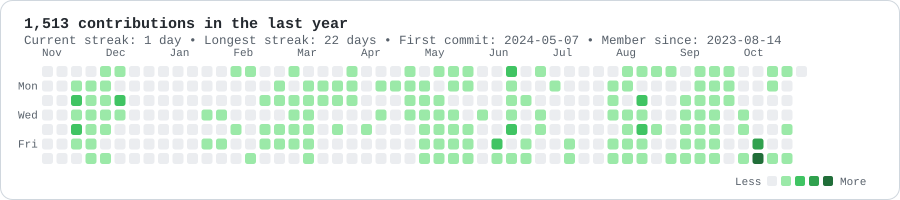

  <code>junior software developer</code> • <code>kisumu, kenya</code> • <code>physicist by training</code>

  <a href="https://github.com/frihk">
    <picture>
      <source media="(prefers-color-scheme: dark)" srcset="dark_mode.svg">
      
    </picture>
  </a>

  <a href="https://github.com/frihk"><strong>GitHub</strong></a> &bull;
  <a href="https://dev.to/frihk"><strong>dev.to</strong></a> &bull;
  <a href="TODO_URL"><strong>LinkedIn</strong></a> &bull;
  <a href="mailto:frihkian05@gmail.com"><strong>Email</strong></a>
   
  <strong>Featured Projects:</strong>
  <a href="https://github.com/frihk/Detecto">Detecto</a> &bull;
  <a href="https://github.com/frihk/guidely">Guidely</a> &bull;
  <a href="https://github.com/frihk/WeatherAIGateway">WeatherAI Gateway</a> &bull;
  <a href="https://github.com/frihk/Skill-match">Skill-match</a> &bull;
  <a href="https://github.com/frihk?tab=repositories">All Repositories</a>

<h3 align="center">Contributions &amp; Milestones</h3>

  <picture>
    <source media="(prefers-color-scheme: dark)" srcset="contributions_dark.svg">
    
  </picture>

  
<strong>Longer bio</strong>

   

I'm **Ian Kimani**, a software developer in Kisumu, Kenya, with a physicist's discipline: I break problems into measurable pieces, test each, and ship what holds up. Backend-focused in Go, JavaScript, and Python, and fluent in React and Next.js, I build complete products.

Don't take my word for it, read the code. **Detecto** counts people in live video using FastAPI and YOLO. **Guidely** answers questions straight from a company's own documents. **WeatherAI Gateway** keeps a weather API inside its quota with smart caching. **Skill-match** tailors your CV to the job you're applying for. My Go articles on [dev.to](https://dev.to/frihk) are backed by real benchmarks, so you can check my numbers too. These are just some of my projects. The rest are in my [repositories](https://github.com/frihk?tab=repositories).

I trained at Zone01, a peer-driven, project-based bootcamp in the 01 Edu network, where there is no teacher at the front of the room. You learn by building, getting stuck, and working it out with the people around you. I'm also part of the Mastercard Foundation Associates Program, implemented by Shortlist Futures in East Africa.

